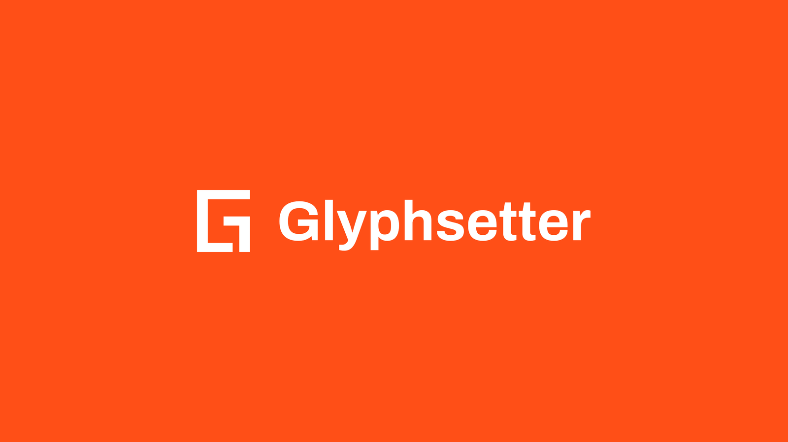
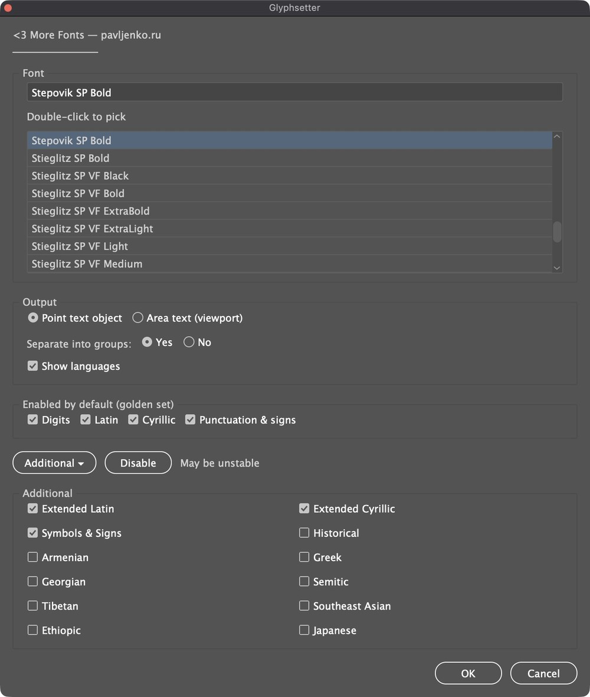
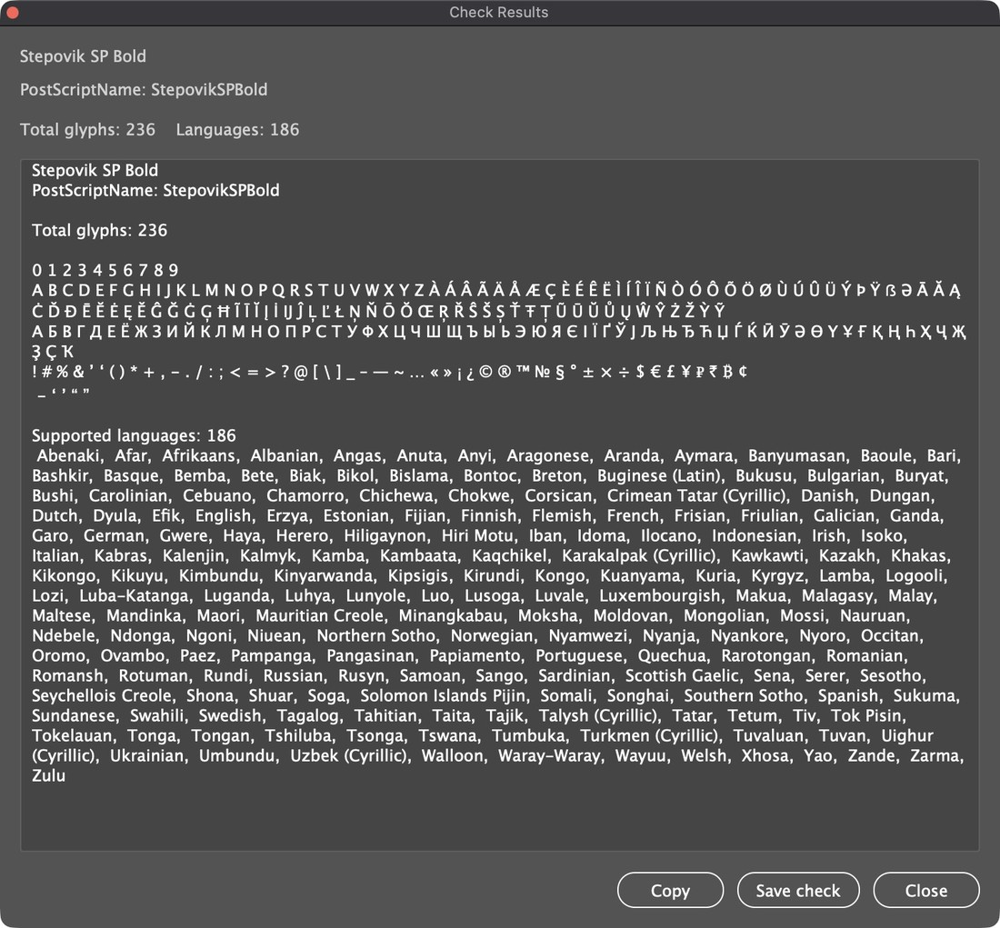
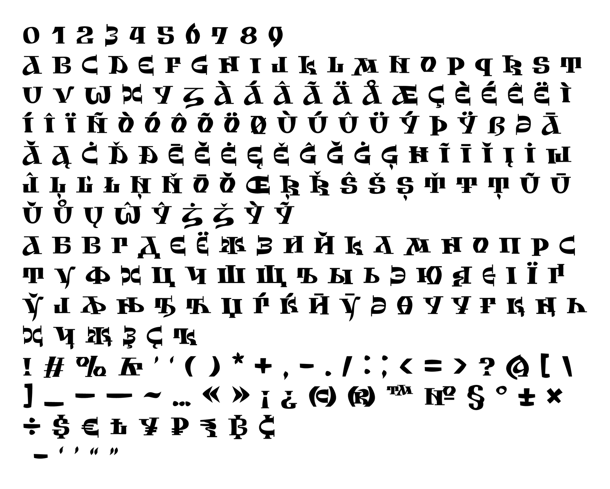
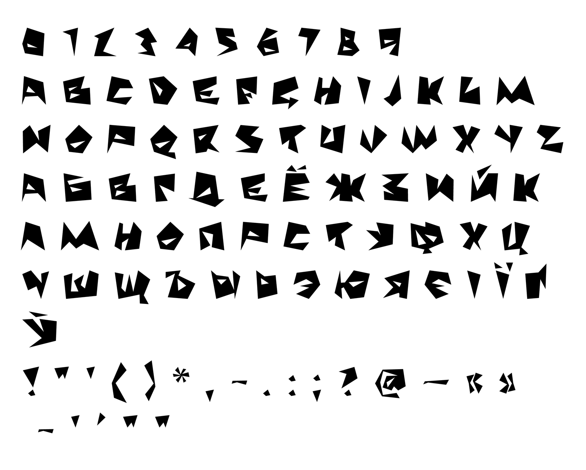

# Glyphsetter

Every glyph a font really has, set on the artboard. A script for Adobe Illustrator.

[Русская версия](README.ru.md)

Glyphsetter (formerly **SP All Write**) is a free ExtendScript for Adobe
Illustrator. Pick a font, and the script builds a text object with the glyphs
the font **actually renders** in Illustrator: digits, Latin, Cyrillic,
punctuation and any extra Unicode blocks you choose. Characters that
Illustrator would draw with a fallback font (tofu, missing glyphs) are left
out, so the specimen shows only what is really in the font. A report lists the
glyph count, the glyphs themselves and, with the optional module, the
languages the font supports.

It is made for type designers and graphic designers who need a quick answer
to "what's inside this font?" right on the artboard.

## What it does

- **A reliable default set.** Digits, Latin, Cyrillic and punctuation & signs
  (with typographic punctuation and currency signs) are explicit, hand-picked
  lists, not broad Unicode ranges, so a basic specimen never scans half of
  Unicode.
- **Extra blocks on demand.** Under **Additional ▸**: Extended Latin, Extended
  Cyrillic, Symbols & Signs (including combining marks), Historical, Armenian,
  Greek, Georgian, Semitic (Hebrew, Arabic and related), Tibetan, Southeast
  Asian, Ethiopic, Japanese.
- **Only real glyphs.** After placing the candidates, the script removes every
  character Illustrator renders with a fallback font.
- **No fake accents.** In display fonts with limited coverage, precomposed
  Latin letters are sometimes just the base letter. The script compares width,
  outline bounds and, for tricky letters such as Ł, Ø, Đ, the point count, and
  skips such duplicates.
- **No pointless case repetition.** If a font has only capitals or only
  lowercase, or both cases look the same, the duplicates are dropped.
- **Two output modes.** A point text object near the top left of the view, or
  an area text box filling the view; in area mode the largest point size that
  still fits is found automatically.
- **Report.** Font name and PostScript name, glyph count, the glyph string and
  (optionally) the supported languages. **Copy** puts it on the clipboard,
  **Save** writes a `.txt` file.

## Installation

Download `Glyphsetter.jsx` (and, for the language list, `Glyphsetter Languages.jsx`)
and copy them into Illustrator's Scripts folder:

- **macOS:** `Applications/Adobe Illustrator <version>/Presets/<language>/Scripts/`
  (for example `en_US` or `ru_RU`)
- **Windows:** `C:\Program Files\Adobe\Adobe Illustrator <version>\Presets\<language>\Scripts\`

Restart Illustrator and run **File → Scripts → Glyphsetter**. To try it once
without installing, use **File → Scripts → Other Script…** and pick
`Glyphsetter.jsx`.

## Usage

1. Open any document.
2. Run **File → Scripts → Glyphsetter**.
3. Pick a font: type to filter the list, double-click a font to choose it.
4. Choose the output: point or area text, groups separated by paragraphs or
   not, show languages or not.
5. Keep the default set or open **Additional ▸** for more blocks.
6. Press **OK**. The text frame is named `AllGlyphs_<PostScriptName>`, and the
   report opens.

The interface is in Russian when Illustrator runs in Russian and in English
otherwise.

## Language list (optional)

`Glyphsetter Languages.jsx` adds the list of languages the font covers to the
report. The main script looks for it next to itself, then in Illustrator's
Scripts folder (`ru_RU`, then `en_US`). The module's old name,
`SP lang All Write.jsx`, is still recognised. If **Show languages** is on and
the module is missing, the script says so and goes on without the list.

## Safe mode

Before the dialog opens, the script checks the environment. If something looks
risky for the Illustrator and system versions in use, it switches to safe mode:
faster scanning shortcuts are off, **Enable all** is hidden and the number of
extra blocks is limited, so the run stays predictable.

## Examples

Stepovik SP Bold — Latin, Cyrillic and extended sets:

Razluka SP Bold — a display font with capitals only, so the lowercase is not repeated:

## Limitations

- **Unicode only.** Glyphs without a code point (stylistic alternates,
  swashes, other unencoded glyphs) are not shown. It is a coverage specimen,
  not an OpenType feature browser.
- **Basic Multilingual Plane only by default.** Code points above U+FFFF are
  off for stability; they can be switched on in the code at your own risk.
- **Large fonts take time.** The outline checks are not free; a progress window
  shows how far the script has got.

## Changes

- **1.1** — renamed from SP All Write to Glyphsetter; the language module is
  now `Glyphsetter Languages.jsx` (the old file name still works).
- **1.0** — first release as SP All Write.

## License

[MIT](LICENSE). Use, change and share freely.

Made by **Sasha Pavljenko** — [pavljenko.ru](https://pavljenko.ru/blogs/scripts/glyphsetter).
AI assistance: OpenAI (ChatGPT).
