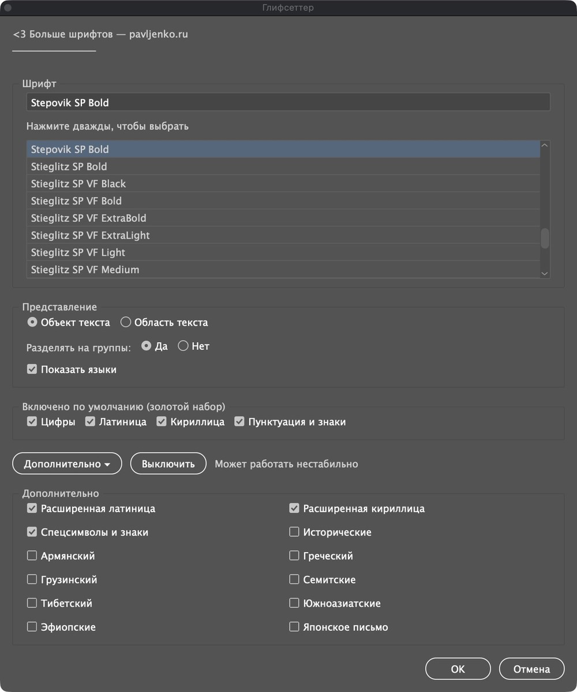
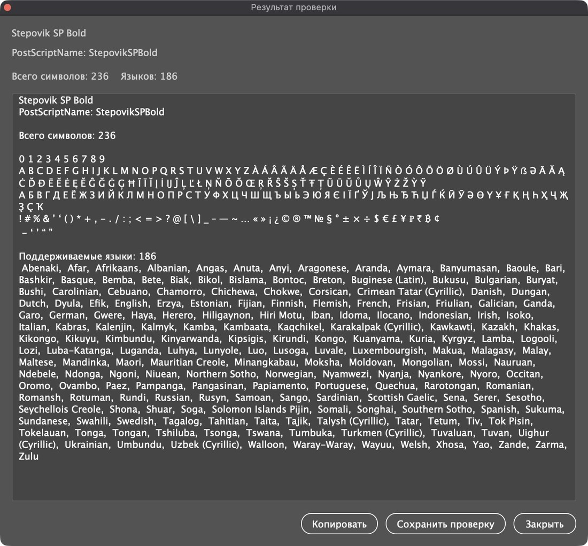

# Глифсеттер

Все знаки, которые действительно есть в шрифте, — на артборде. Скрипт для Adobe Illustrator.

[English version](README.md)

Глифсеттер (раньше — **SP All Write**) — бесплатный скрипт ExtendScript для
Adobe Illustrator. Выберите шрифт, и скрипт соберёт текстовый объект из
знаков, которые шрифт **на самом деле отображает** в Illustrator: цифры,
латиница, кириллица, пунктуация и любые дополнительные блоки Юникода. Знаки,
которые Illustrator нарисовал бы запасным шрифтом («тофу», пропущенные
глифы), в образец не попадают — остаётся только то, что в шрифте есть. В отчёте —
число знаков, сами знаки и, с дополнительным модулем, языки, которые
поддерживает шрифт.

Скрипт для дизайнеров шрифтов и графических дизайнеров, которым нужно быстро
ответить на вопрос «что внутри этого шрифта?» прямо на артборде.

## Что умеет

- **Надёжный набор по умолчанию.** Цифры, латиница, кириллица, пунктуация и
  знаки (с типографской пунктуацией и знаками валют) — это выверенные списки,
  а не широкие диапазоны Юникода, поэтому базовый образец не перебирает
  пол-Юникода.
- **Дополнительные блоки по желанию.** В разделе **Дополнительно ▸**:
  расширенная латиница, расширенная кириллица, спецсимволы и знаки (включая
  комбинируемые диакритики), исторические, армянский, греческий, грузинский,
  семитские (иврит, арабское письмо и родственные), тибетский,
  южноазиатские, эфиопские, японское письмо.
- **Только настоящие знаки.** Расставив кандидатов, скрипт убирает всё, что
  Illustrator рисует запасным шрифтом.
- **Без фальшивых акцентов.** В акцидентных шрифтах с неполным набором
  латинские буквы с диакритикой бывают просто копией базовой буквы. Скрипт
  сравнивает ширину, габариты контура, а для сложных букв вроде Ł, Ø, Đ — ещё
  и число точек, и такие дубли пропускает.
- **Без лишнего повтора регистров.** Если в шрифте только прописные или только
  строчные или оба регистра выглядят одинаково, повтор убирается.
- **Два вида вывода.** Объект текста у левого верхнего угла вида или область
  текста во весь вид; в режиме области кегль подбирается автоматически —
  самый крупный, при котором текст помещается.
- **Отчёт.** Название шрифта и PostScript-имя, число знаков, строка знаков и
  (по желанию) поддерживаемые языки. **Копировать** — в буфер обмена,
  **Сохранить** — в файл `.txt`.

## Установка

Скачайте `Glyphsetter.jsx` (и для списка языков — `Glyphsetter Languages.jsx`)
и положите в папку скриптов Illustrator:

- **macOS:** `Программы/Adobe Illustrator <версия>/Presets/<язык>/Scripts/`
  (например, `ru_RU` или `en_US`)
- **Windows:** `C:\Program Files\Adobe\Adobe Illustrator <версия>\Presets\<язык>\Scripts\`

Перезапустите Illustrator и выберите **Файл → Сценарии → Glyphsetter**. Чтобы
один раз попробовать без установки — **Файл → Сценарии → Другой сценарий…** и
файл `Glyphsetter.jsx`.

## Как пользоваться

1. Откройте любой документ.
2. Запустите **Файл → Сценарии → Glyphsetter**.
3. Выберите шрифт: начните вводить название, чтобы сузить список, и дважды
   щёлкните по шрифту.
4. Выберите вывод: объект или область текста, разделять ли группы абзацами,
   показывать ли языки.
5. Оставьте набор по умолчанию или откройте **Дополнительно ▸**.
6. Нажмите **OK**. Текстовый фрейм получит имя `AllGlyphs_<PostScript-имя>`,
   откроется отчёт.

Интерфейс по-русски, если Illustrator работает на русском, иначе — по-английски.

## Список языков (по желанию)

`Glyphsetter Languages.jsx` добавляет в отчёт список языков, которые покрывает
шрифт. Основной скрипт ищет модуль рядом с собой, потом в папке скриптов
Illustrator (сначала `ru_RU`, затем `en_US`). Старое имя модуля,
`SP lang All Write.jsx`, тоже подходит. Если включено **Показать языки**, а
модуля нет, скрипт предупредит и продолжит без списка.

## Безопасный режим

Перед открытием окна скрипт проверяет окружение. Если сочетание версий
Illustrator и системы выглядит рискованным, включается безопасный режим:
ускоренный перебор выключен, кнопки **Включить все** нет, число
дополнительных блоков ограничено — так работа остаётся предсказуемой.

## Примеры

Stepovik SP Bold — латиница, кириллица и расширенные наборы:

Razluka SP Bold — акцидентный шрифт только с прописными, поэтому строчные не повторяются:

## Ограничения

- **Только Юникод.** Знаки без кода (стилистические альтернативы, росчерки и
  другие незакодированные глифы) не показываются. Это образец покрытия, а не
  просмотрщик функций OpenType.
- **По умолчанию — только основная плоскость Юникода.** Коды выше U+FFFF
  выключены ради стабильности; их можно включить в коде на свой риск.
- **Большие шрифты — дольше.** Проверки контуров требуют времени; окно
  прогресса показывает, сколько сделано.

## Изменения

- **1.1** — SP All Write переименован в Глифсеттер (Glyphsetter); модуль
  языков теперь называется `Glyphsetter Languages.jsx` (старое имя файла
  тоже работает).
- **1.0** — первый выпуск под именем SP All Write.

## Лицензия

[MIT](LICENSE). Можно свободно использовать, менять и распространять.

Автор — **Саша Павленко**, [pavljenko.ru](https://pavljenko.ru/blogs/scripts/glyphsetter).
Помощь ИИ: OpenAI (ChatGPT).
